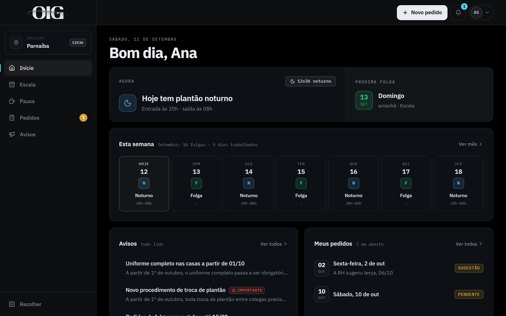
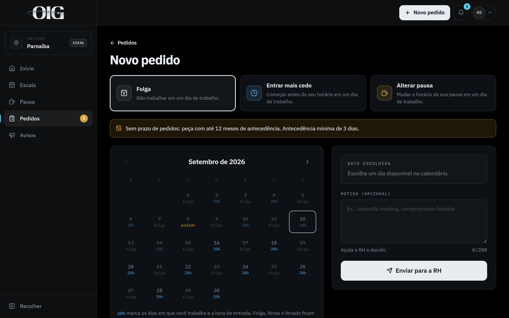
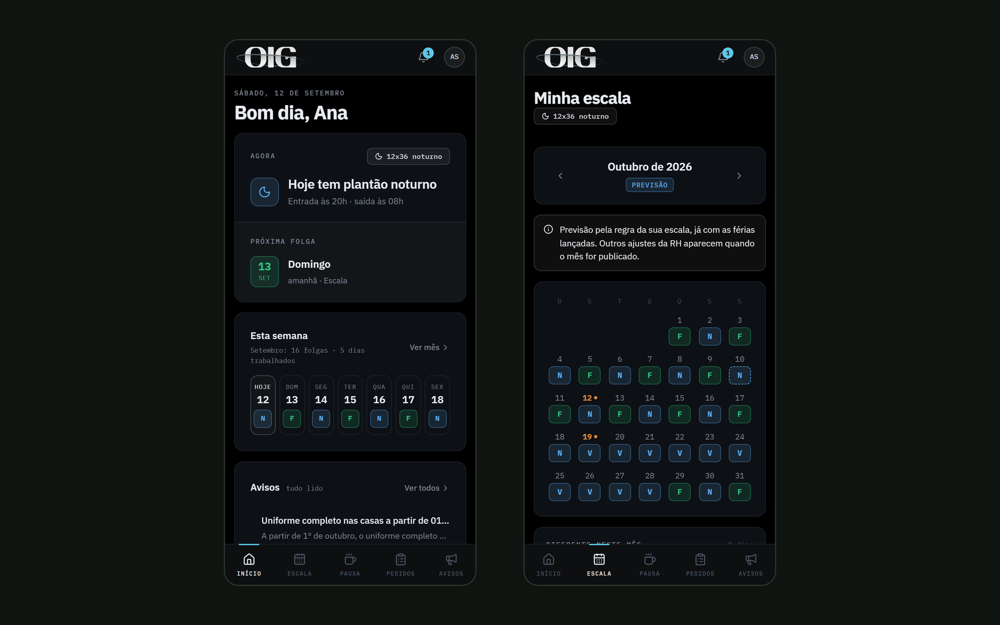

## O problema

A escala do mês é uma planilha que a RH monta e manda no WhatsApp. O objetivo é padronizar as escalas e fazer com que qualquer colaborador consiga prever o seu mês.

Daqui para frente, quem tem escala fixa, como a 12x36, consegue ver os próximos meses e as férias, pedir troca de folga e acompanhar tudo marcado no sistema, com os detalhes de cada dia.

## Decisões

- **Escalas que se calculam sozinhas.** As escalas por regra, como 12x36 e 5x2 com folga no fim de semana, saem prontas. As que dependem de escolha ganham um rascunho gerado, que a RH ajusta clicando ou arrastando as folgas.
- **Publicação controlada.** Até a RH publicar o mês, o colaborador vê "Em montagem". Mudanças feitas depois ficam guardadas até a RH salvar, e só então o colaborador é avisado.
- **Pedidos dentro de regras.** Folga, entrada mais cedo e mudança de pausa seguem prazos e limites por cidade, e a RH vê a cobertura do dia antes de aprovar.
- **App instalável (PWA)**, com notificações no celular e exportação da escala para o calendário do aparelho.
- **Acesso por página e por cidade**, para que cada admin veja só o que lhe cabe.

## O sistema

### Para o colaborador

Na tela inicial, o colaborador vê o turno de hoje, a próxima folga, a semana inteira e os seus pedidos.

Quem tem escala fixa já vê os meses seguintes, calculados pela regra da escala e com as férias lançadas, antes mesmo de a RH publicar o mês.

Para pedir folga, entrar mais cedo ou mudar a pausa, o calendário mostra só os dias que podem ser escolhidos.

No celular, a navegação fica numa barra embaixo da tela.

### Para a RH

No Quadro de escala, a RH vê o mês inteiro de uma cidade, com as folgas de cada pessoa, o limite de folgas por dia e os alertas.

Antes de aprovar um pedido, a RH vê quantas pessoas trabalham e quantas folgam no dia pedido e nos dias ao lado.

Telas com dados fictícios do ambiente de demonstração.

## Resultado

O app foi solicitado pela RH e ainda não está em produção. Por enquanto, não há previsão para entrar em produção.
