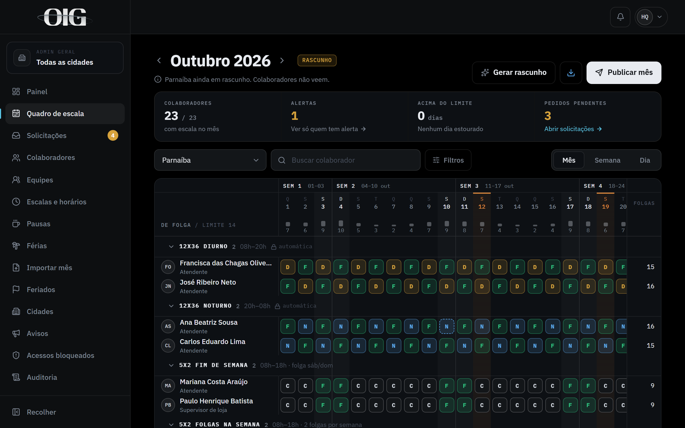
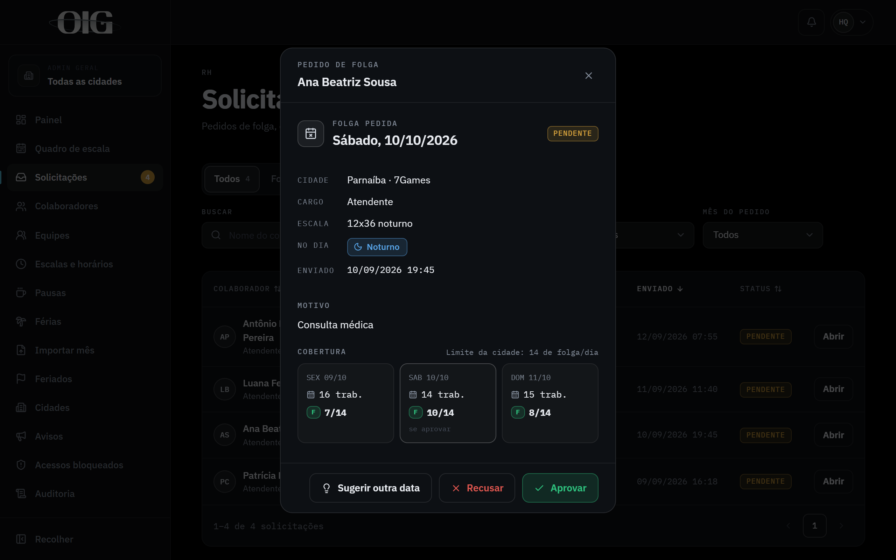
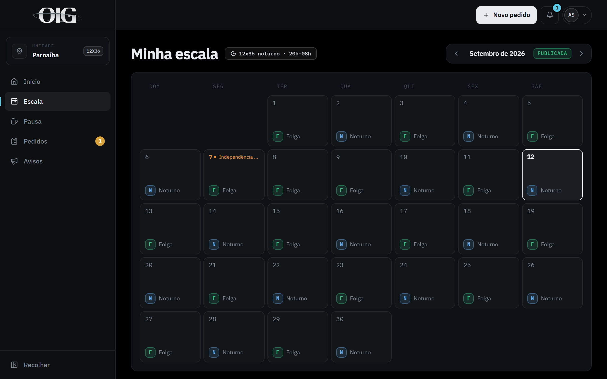

## O problema

A escala do mês era uma planilha que a RH montava e mandava no WhatsApp. [COMO ERA LIDAR COM PEDIDOS DE FOLGA E MUDANÇAS NA ESCALA ANTES DO APP]

## Decisões

- **Escalas que se calculam sozinhas.** As escalas por regra, como 12x36 e 5x2 com folga no fim de semana, saem prontas. As que dependem de escolha ganham um rascunho gerado, que a RH ajusta clicando ou arrastando as folgas.
- **Publicação controlada.** Até a RH publicar o mês, o colaborador vê "Em montagem". Mudanças feitas depois ficam guardadas até a RH salvar, e só então o colaborador é avisado.
- **Pedidos dentro de regras.** Folga, entrada mais cedo e mudança de pausa seguem prazos e limites por cidade, e a RH vê a cobertura do dia antes de aprovar.
- **App instalável (PWA)**, com notificações no celular e exportação da escala para o calendário do aparelho.
- **Acesso por página e por cidade**, para que cada admin veja só o que lhe cabe.

## O sistema

No Quadro de escala, a RH vê o mês inteiro de uma cidade, com as folgas de cada pessoa, o limite de folgas por dia e os alertas.

Antes de aprovar um pedido, a RH vê quantas pessoas trabalham e quantas folgam no dia pedido e nos dias ao lado.

O colaborador acompanha a própria escala num calendário, com os plantões, as folgas e os feriados do mês.

Telas com dados fictícios do ambiente de demonstração.

## Resultado

[RESULTADO]
