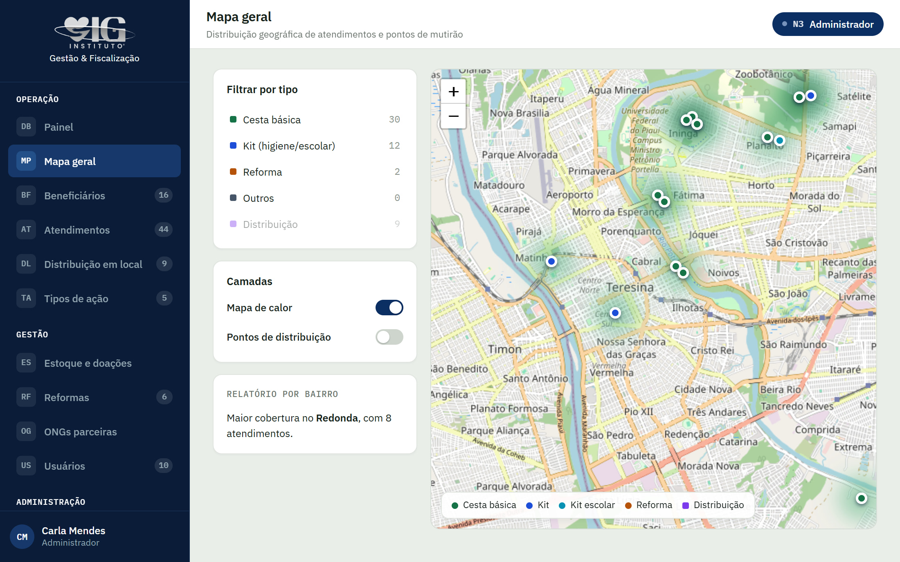
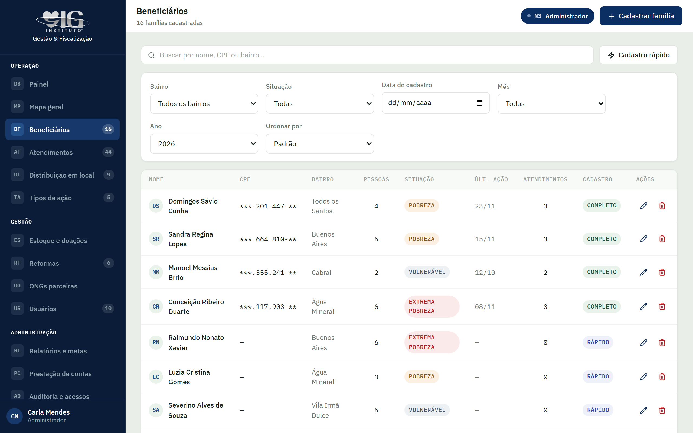
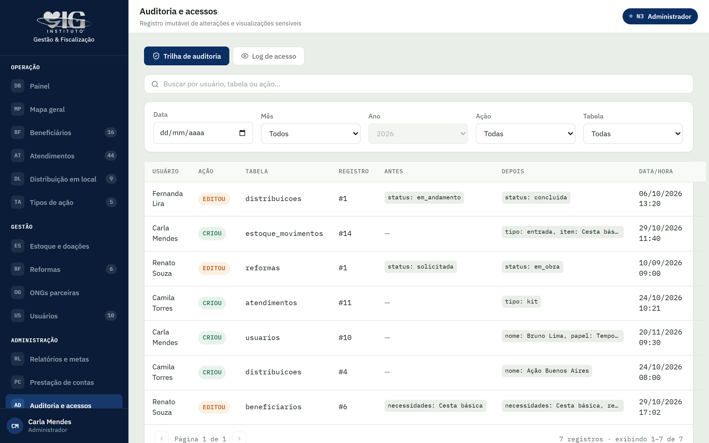

## O problema

Este é um estudo de caso: o sistema não foi encomendado. Vi que o Instituto OIG precisava acompanhar cada beneficiário do primeiro cadastro até a entrega da reforma da casa. Isso exigia dados confiáveis, sem cadastros duplicados, com o histórico de cada etapa da obra e o registro de quem fez cada alteração.

## Decisões

- **Servidor próprio na Hostinger Cloud**, em vez de Supabase ou Vercel, para ter controle total sobre os dados dos beneficiários.
- **Níveis de acesso N1, N2 e N3**, para que cada pessoa da equipe veja e altere apenas o que precisa.
- **Usuários temporários de 24 horas**, para dar acesso pontual sem deixar contas abertas.
- **Validação de CPF via API** no momento do cadastro, junto com a detecção de cadastros duplicados.
- **Exportação em PDF e planilha**, para relatórios e prestação de contas.

## O sistema

O mapa geral cruza os atendimentos com a localização de cada família e mostra, em mapa de calor, os bairros com mais ações.

A lista de beneficiários reúne CPF, bairro, situação e o histórico de atendimentos de cada família, com filtros e cadastro rápido para os mutirões.

Toda criação ou alteração entra na trilha de auditoria, com o usuário, o registro e o valor antes e depois.

Telas com dados fictícios do ambiente de demonstração.

## Resultado

O sistema ainda não foi adotado pelo instituto e não está em produção.
