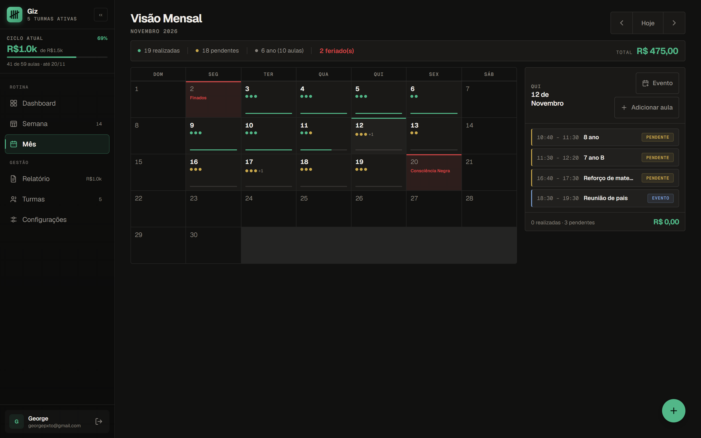
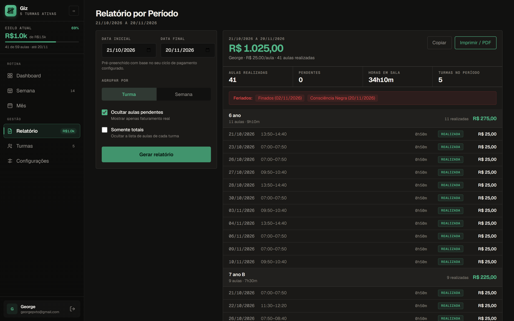
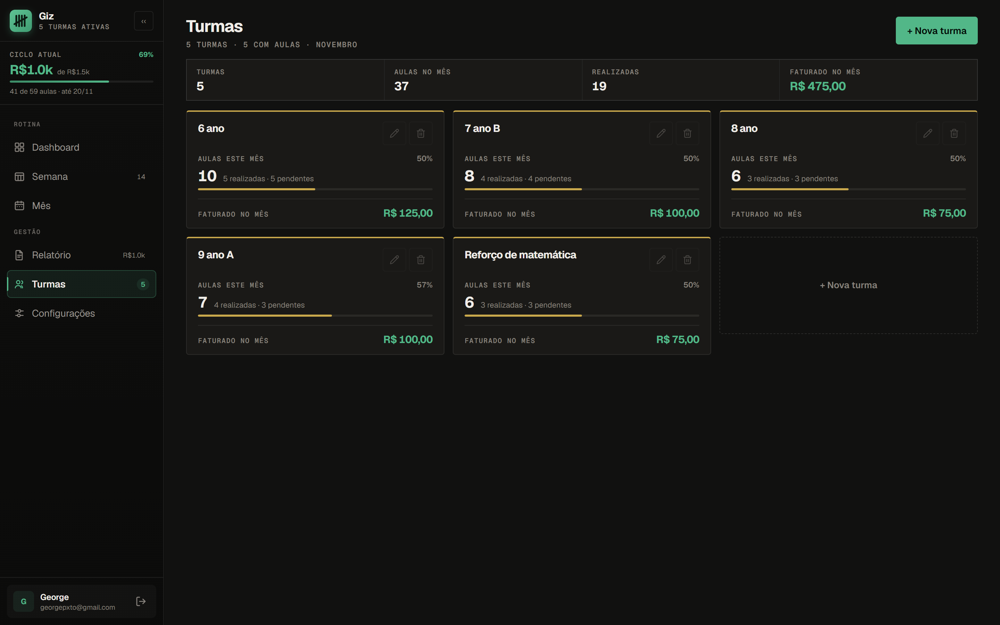
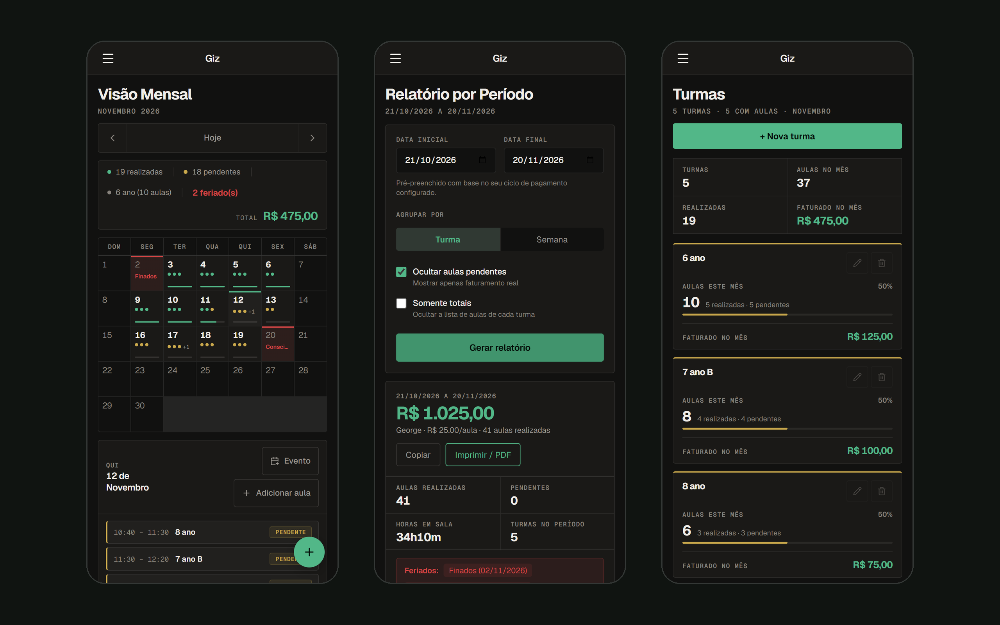

## O problema

Uma professora particular dá aula para várias turmas, em horários que mudam ao longo da semana, e recebe por hora/aula num ciclo que não fecha no fim do mês: vai do dia 21 de um mês ao dia 20 do seguinte. Fechar o ciclo exige saber quantas aulas foram dadas de fato, quais caíram em feriado e quanto isso dá em reais.

O Giz foi feito exclusivamente para ela: uma pessoa só, usando todo dia, no computador e às vezes no celular.

## Decisões

- **Só conta o que foi dado.** Toda aula nasce pendente e passa a valer quando é marcada como realizada. O valor a receber é o número de aulas realizadas vezes o valor da hora/aula.
- **Ciclo de pagamento configurável**, por mês calendário ou por dia fixo, como do dia 21 ao dia 20. O painel e o relatório seguem o ciclo, não o mês.
- **Lançamento em lote** com recorrência semanal, porque a grade se repete toda semana.
- **Feriados e eventos fora da conta.** Feriados ficam marcados no calendário, e atividades que não são aula, como reunião de pais, aparecem na agenda e no relatório sem entrar no valor a receber.
- **Firebase em tempo real**, com login pelo Firebase Auth e os dados de cada conta guardados separados no Firestore.
- **CSS próprio, sem framework**, com tema claro e escuro e contraste AA nas cores de texto e de status.

## O sistema

A semana é a tela do dia a dia: cada aula mostra o horário, a turma e se já foi dada, e um clique numa aula pendente marca como realizada.

No mês, os pontos de cada dia mostram as aulas realizadas em verde e as pendentes em amarelo, e os feriados aparecem em vermelho. Ao escolher um dia, o painel ao lado lista as aulas e os eventos.

O relatório já vem com as datas do ciclo atual. Agrupa por turma ou por semana, pode esconder as pendentes e mostra as horas em sala e os feriados do período, pronto para copiar ou imprimir em PDF.

Em Turmas, cada turma mostra as aulas do mês, quantas já foram dadas e quanto rendeu.

No celular, o menu vira uma gaveta e as telas se reorganizam numa coluna só.

Telas com dados fictícios de uma conta de teste.

## Resultado

O Giz está em uso todos os dias pela professora para quem foi feito. Por ser um app pessoal, com login, não tem link público.
