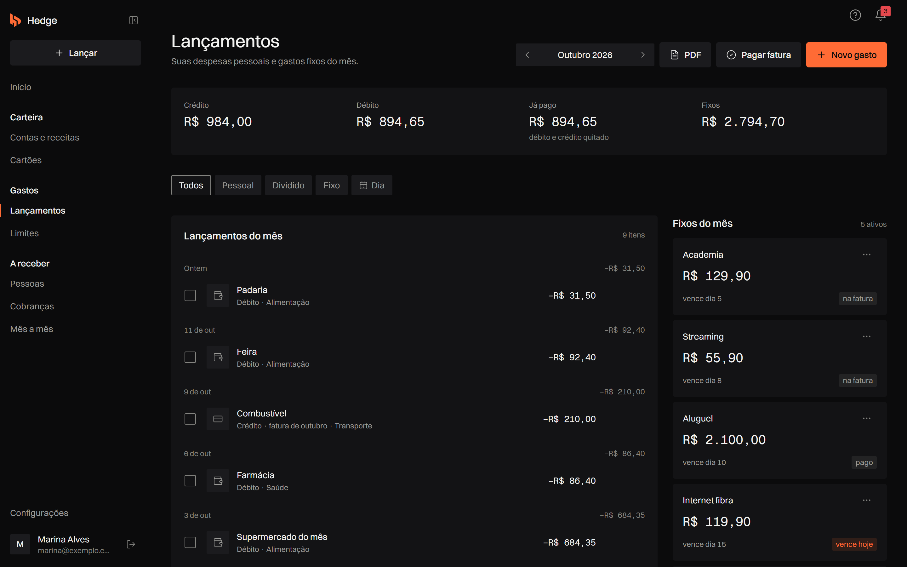
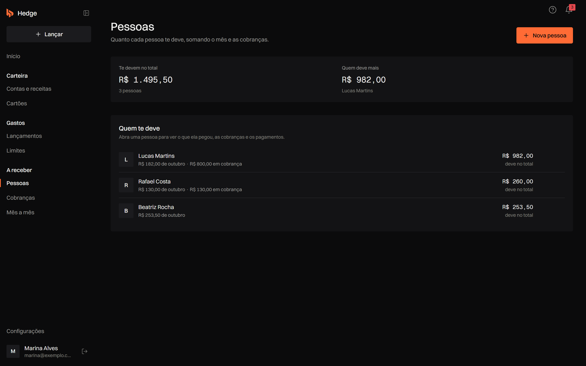
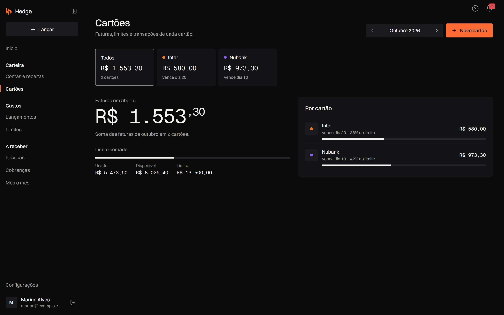
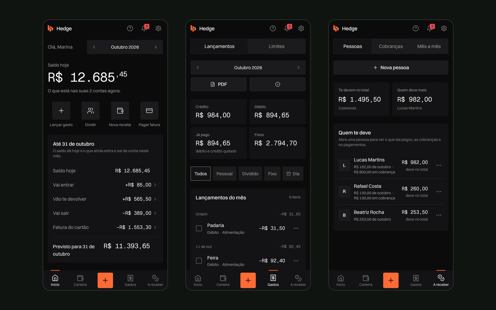

## O problema

Um app de controle de gastos comum registra só a parte de quem usa. Quando a conta é dividida com amigos, o dinheiro sai inteiro e volta em pedaços, e acompanhar quem já pagou vira uma lista separada.

O Hedge responde em poucos segundos três perguntas: quanto tenho hoje, quanto vou ter no fim do mês e quanto ainda tenho a receber.

## Decisões

- **Dividir e cobrar na mesma conta.** Um gasto dividido já gera a cobrança de cada pessoa em A receber, e o que elas devolvem entra no saldo e na previsão do fim do mês. Editar ou excluir o gasto atualiza a cobrança.
- **Saldo calculado, nunca digitado.** O saldo de hoje vem do histórico: saldo inicial, mais entradas, menos saídas.
- **Renda fixa só entra depois de confirmada**, com registro de adiantamento, atraso ou valor diferente, para a previsão não contar com um dinheiro que ainda não caiu.
- **Sem integração bancária.** A conta nasce com o saldo que o banco mostra hoje, e o cartão é conferido com o limite disponível e a próxima fatura do app do banco.
- **Row Level Security no Supabase**, para que cada pessoa veja só os próprios dados.
- **Testes nas regras de dinheiro** com Vitest e fluxos de ponta a ponta com Playwright.

## O sistema

Os lançamentos do mês separam débito, crédito, gastos divididos e fixos, com parcelamento em até 48 vezes e relatório em PDF.

Em Pessoas, cada um que divide gastos com você aparece com quanto deve, somando o mês e as cobranças em aberto.

Os cartões mostram a fatura de cada um, o limite usado e o disponível.

No celular, a navegação fica numa barra embaixo, com o botão de lançar no centro.

Telas com dados fictícios de uma conta de demonstração.

## Resultado

O Hedge está no ar em gethedge.vercel.app, gratuito e sem anúncios.
