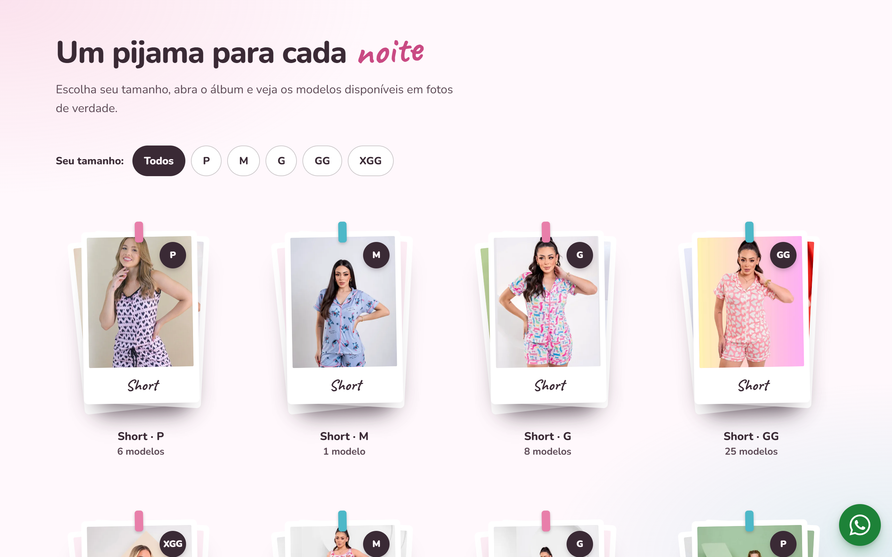
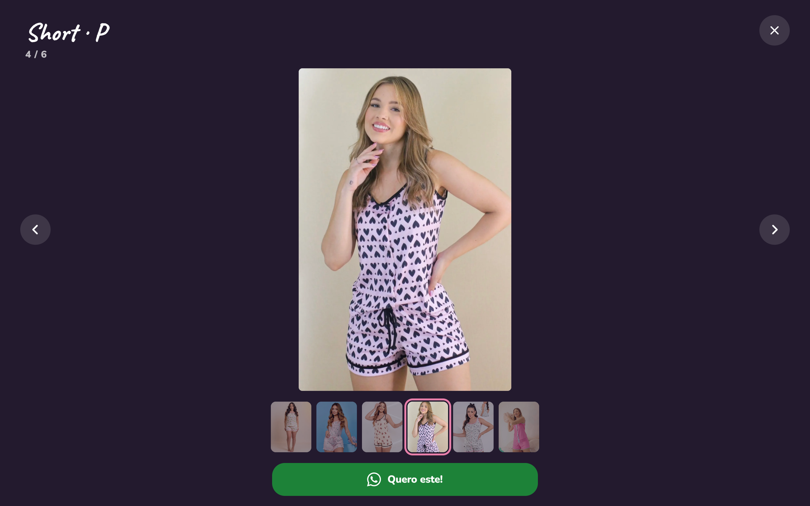
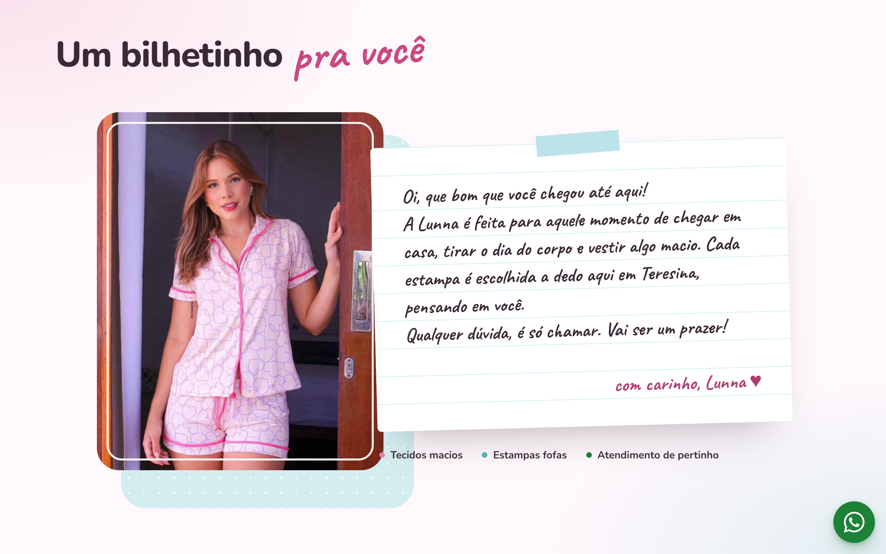
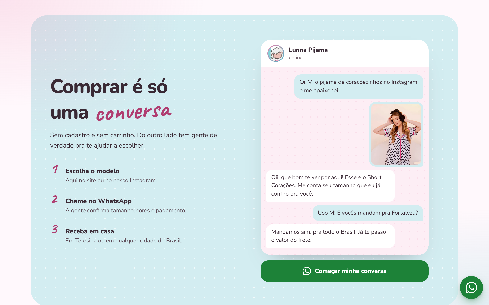
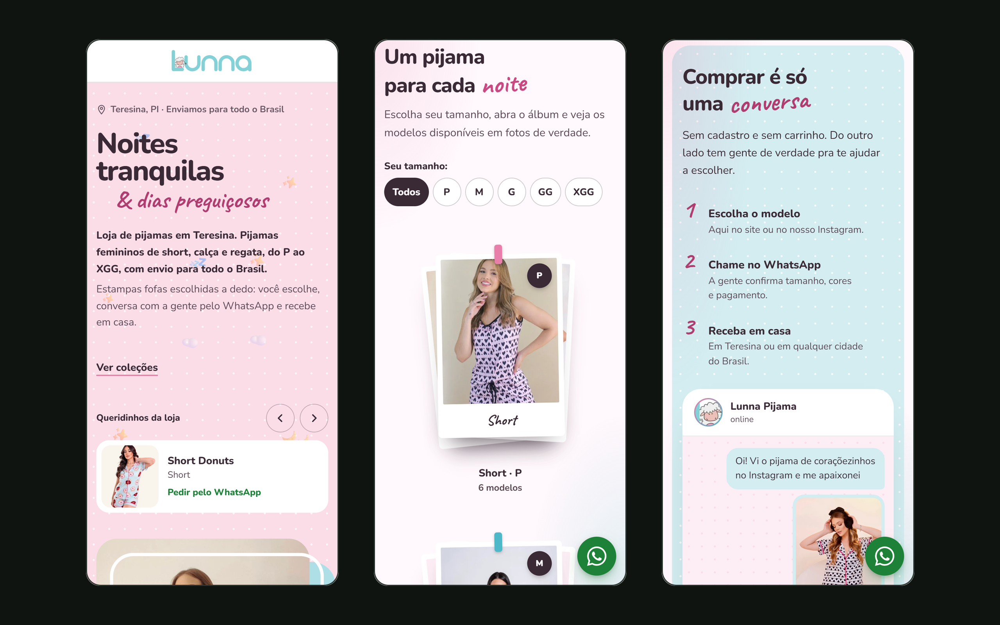

## O problema

A Lunna Pijama precisava de um site de apresentação da marca. O ponto de partida foi o que a loja já tinha: o conteúdo do Instagram e o logo. O design foi feito a partir deles, com as cores, a letra manuscrita e o tom acolhedor da marca.

## Decisões

- **Design a partir do Instagram e do logo**, para que quem chega pelo perfil reconheça a loja na hora.
- **HTML, CSS e JavaScript puros, sem framework**, porque a maioria das clientes chega pelo link do Instagram, no celular, e a página precisa abrir rápido.
- **Fotos vindas dos álbuns do Google Fotos da loja**, importadas por um script que otimiza cada imagem. Para atualizar o catálogo, basta rodar o script de novo.
- **Compra pelo WhatsApp, sem carrinho e sem cadastro.** No álbum, o botão "Quero este!" já abre a conversa dizendo o tamanho e qual foto a cliente escolheu.
- **SEO local**, com dados estruturados de loja em Teresina, sitemap e Open Graph, e publicação na Vercel.
- **De link na bio a site da marca.** O projeto começou como uma página de links para o Instagram e virou o site completo. O endereço antigo redireciona para a página principal.

## O sistema

As coleções viram um provador: cada tamanho é uma pilha de polaroids, com filtro de P a XGG.

Ao abrir um álbum, as fotos aparecem em tela cheia, com as miniaturas embaixo e o botão para pedir pelo WhatsApp.

O "bilhetinho" apresenta a loja num cartão escrito à mão, no tom da marca.

A seção de compra mostra o passo a passo e uma conversa de exemplo no WhatsApp.

No celular, onde está a maior parte do público, o site mantém o mesmo cuidado.

## Resultado

O site está no ar em lunnapijama.com.br.
