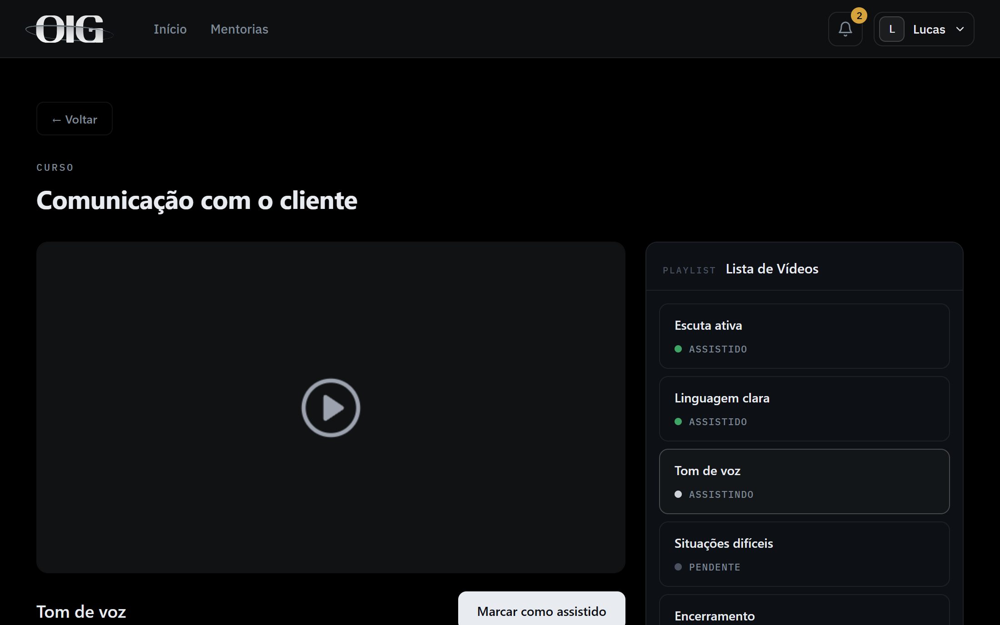
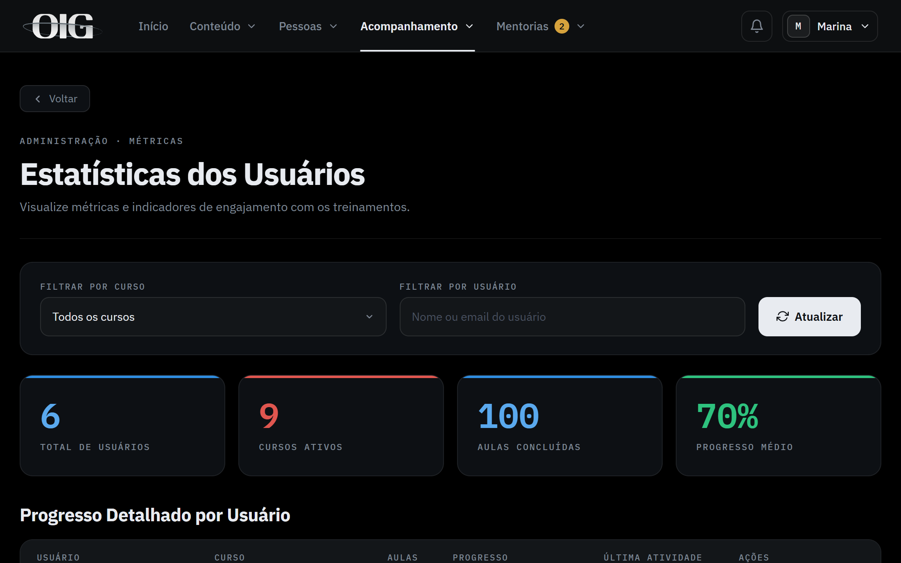
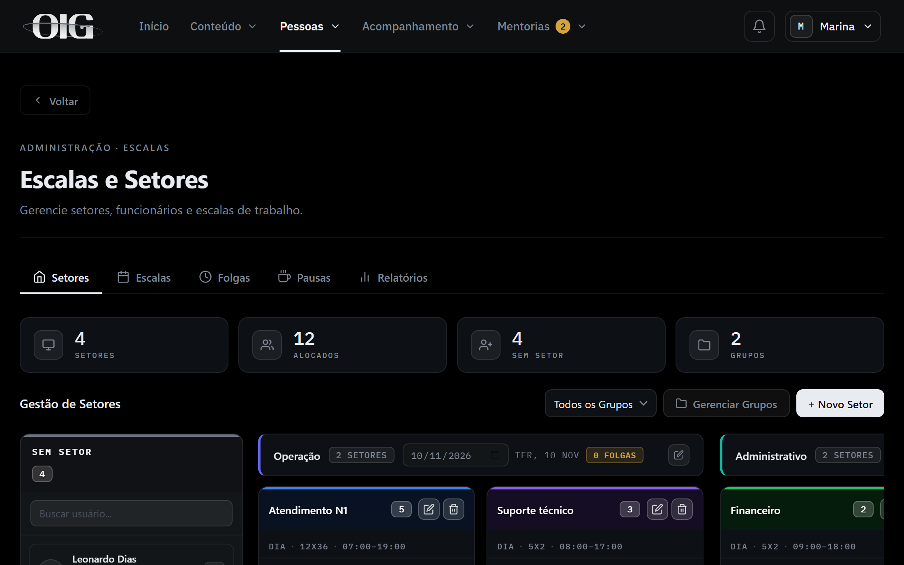
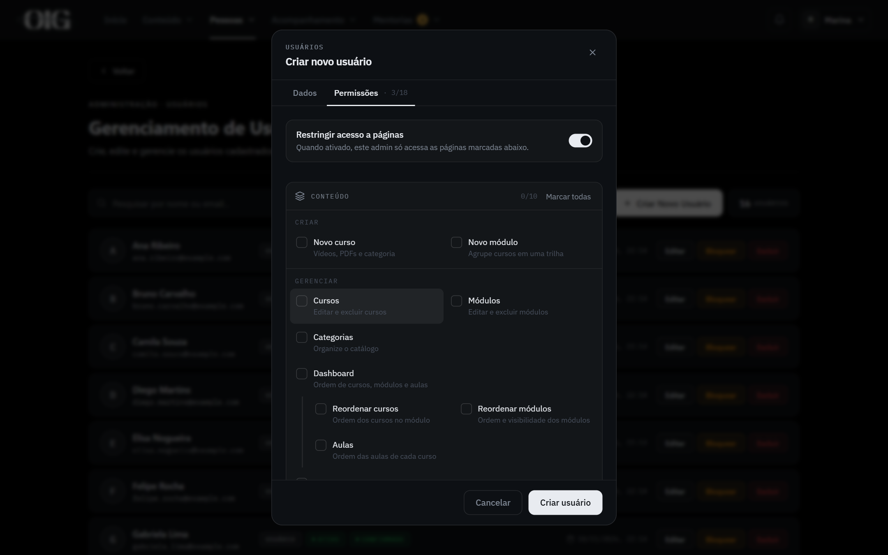

## O problema

Conforme a empresa foi crescendo, percebemos que não havia um treinamento padronizado. A ideia de criar um sistema para reunir tudo em um só lugar foi minha: videoaulas, manuais e a gestão de RH na mesma plataforma.

## Decisões

- **Vídeos no Google Drive, em vez de hospedados na plataforma**, porque a empresa já guardava os vídeos lá e assim não há custo de armazenamento nem de banda.
- **Front-end em HTML, CSS e JavaScript puros, sem framework nem build**, porque o Express serve os arquivos como estão e o deploy no Plesk fica simples.
- **Treinamento e RH no mesmo sistema**, com setores, escalas, folgas, pausas e mentorias, porque a equipe já entra na plataforma todo dia e tudo fica num lugar só.
- **Permissões por página definidas pelo owner**, para dar a cada administrador só as telas de que ele precisa, sem acesso total.
- **O curso reabre na aula em que a pessoa parou**, para que ela não precise procurar onde estava.
- **Relatórios de progresso em PDF e planilha gerados no servidor**, para a RH acompanhar quem concluiu cada treinamento.

## O sistema

Cada curso tem o player, a lista de aulas e os materiais em PDF. A plataforma reabre o curso na aula em que a pessoa parou.

A administração acompanha o progresso de cada pessoa em cada curso, com filtros e relatórios.

O RH organiza as pessoas por setor em um kanban de arrastar e soltar, com escalas, folgas e pausas.

O owner define, por conta, quais páginas cada administrador pode acessar.

Telas com dados fictícios do ambiente de demonstração.

## Resultado

O problema foi resolvido com a padronização: o treinamento passou a ser o mesmo para todos, com as videoaulas e os manuais reunidos na plataforma.
