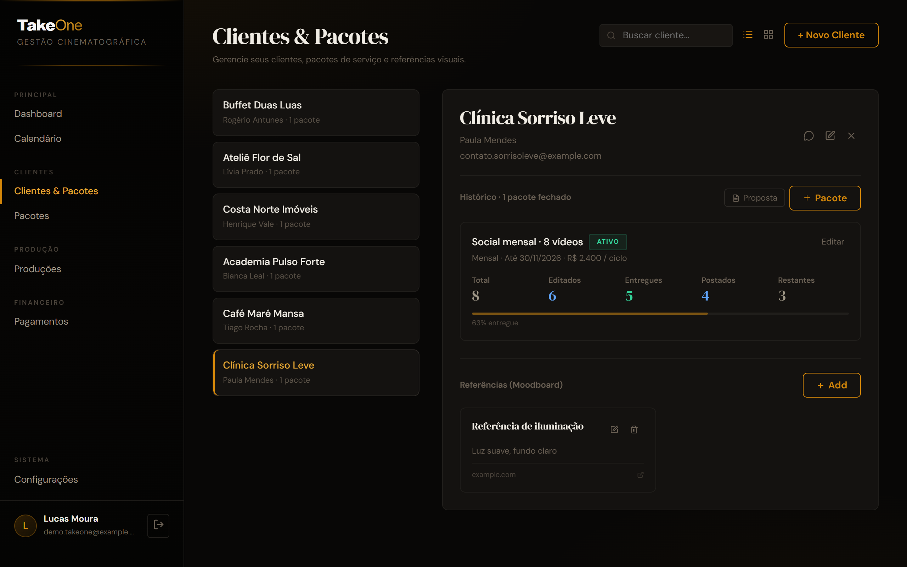
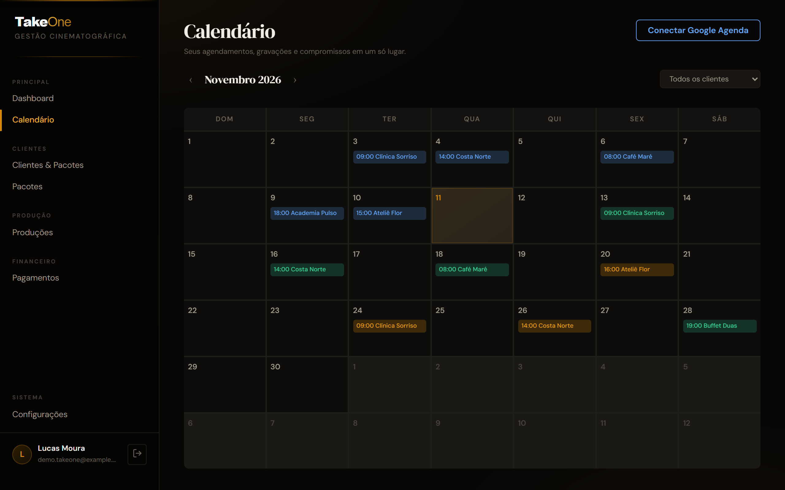
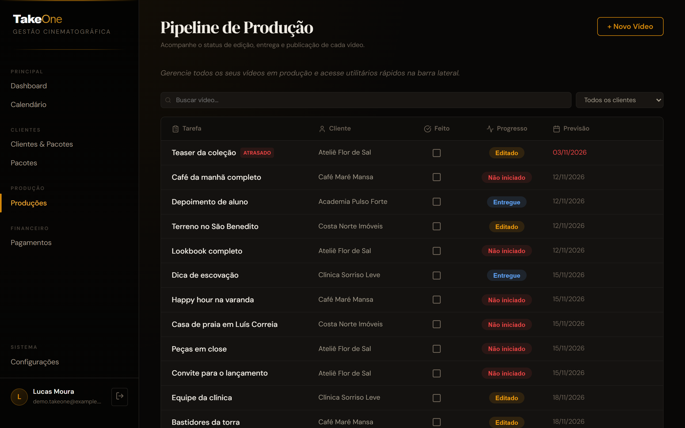
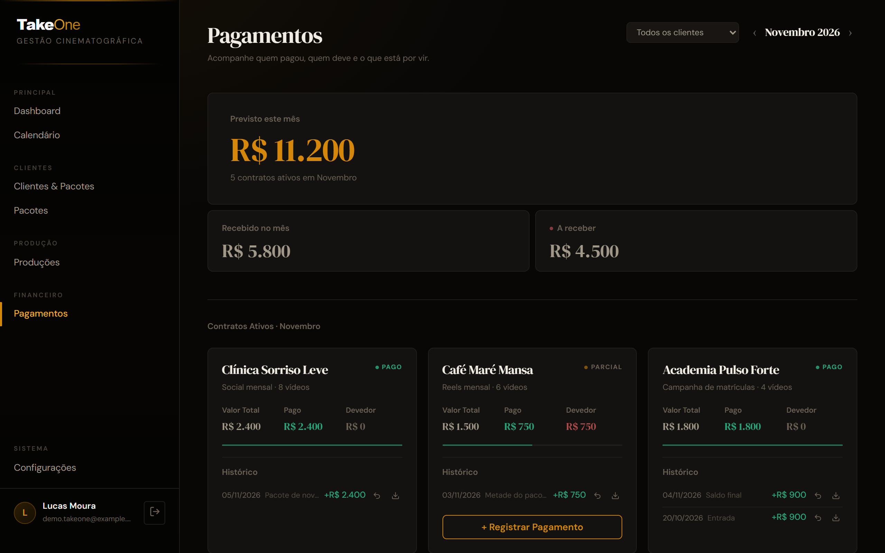

## O problema

Percebi que alguns filmmakers não conseguem se organizar direito: os clientes, os valores combinados, as datas de gravação e o que já foi entregue ficam espalhados entre planilhas e conversas no WhatsApp. O TakeOne foi feito para isso, para que eles consigam se organizar por cliente, por valor e pelo calendário, tudo no mesmo lugar.

## Decisões

- **Supabase com RLS em todas as tabelas** (`user_id = auth.uid()`), para que cada usuário veja só os próprios dados, mesmo com todos no mesmo banco.
- **Sincronização nos dois sentidos com o Google Calendar**, com os tokens criptografados (AES-256) numa Edge Function, porque o filmmaker já usa a agenda do Google.
- **Atualizações otimistas:** a tela muda na hora e volta atrás se o salvamento falhar, porque o app precisa ser rápido entre uma gravação e outra.
- **Propostas e recibos em PDF gerados no próprio navegador**, sem depender de um servidor para isso.

## O sistema

O dashboard mostra o previsto do mês, as gravações da semana, os alertas de pacotes que precisam de renovação ou com saldo devedor e a receita dos últimos seis meses.

Em Clientes & Pacotes, cada cliente tem o histórico de pacotes, o progresso dos vídeos e um moodboard de referências.

O calendário reúne as gravações do mês, com o status de cada uma, e pode ser ligado ao Google Calendar.

O pipeline de produção acompanha cada vídeo da edição até a publicação e marca o que está atrasado.

Em Pagamentos, o filmmaker vê o previsto, o recebido e o que falta receber, com o histórico de cada contrato.

Telas com dados fictícios de uma conta de demonstração.

## Resultado

O TakeOne ainda não está em uso.
